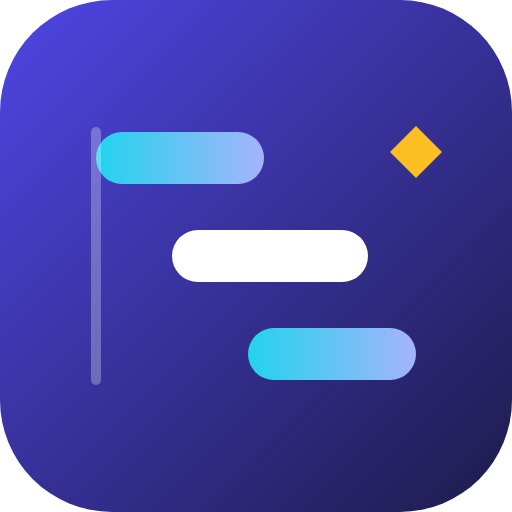

<div align="center">



**A free project planner that runs in the browser.**

Build a WBS, a Gantt chart, a critical-path network diagram, a resource plan and a budget without a paid licence.


</div>

---

## Table of contents

- [About](#about)
- [Features](#features)
- [Tech stack](#tech-stack)
- [Getting started](#getting-started)
- [Usage](#usage)
- [Project structure](#project-structure)
- [Contributing](#contributing)
- [Author](#author)
- [License](#license)

## About

Neo Project is a project management tool for students and small teams who need to plan a project with the standard techniques (WBS, Gantt chart, critical path method, resource allocation and budgeting) but don't have access to paid desktop software.

It runs entirely in the browser and has no server or account. Projects are saved on your own computer.

## Features

- **Gantt chart**: an outline of summary tasks and subtasks, FS/SS/FF/SF links with lag, milestones, constraints, deadlines, split tasks and a timeline strip. You can drag bars to move tasks, resize them or link them.
- **Critical path**: forward and backward passes that give ES, EF, LS, LF, total slack and free slack.
- **Diagrams**: a network diagram (activity on node), a WBS chart and a team org chart. Each one exports to PNG or SVG.
- **Resources**: work, material and cost resources, calendars, vacations, rate changes, a workload heatmap and resource leveling.
- **Tracking**: baselines, % complete, actual dates, a status date and earned value (SPI, CPI, EAC).
- **Budget and reports**: cost by work package and by resource, monthly and cumulative cost, and 10 ready-made reports.
- **Task board**: a Not started / In progress / Done board; dragging a card updates its % complete.
- **Getting started**: templates (final-year project, software sprint, event, research project) and a first-run checklist.
- **Files**: save to `.neoproject` files, open them by double-clicking once the app is installed, import task lists from Excel or CSV, and export Excel (.xlsx) and CSV.
- **Sharing and versions**: share a copy of a plan as a link (the plan travels inside the link, nothing is uploaded), and save named versions in the browser.
- **Offline**: once installed or visited, the app works without an internet connection.
- **Interface**: a tabbed toolbar that you can hide, keyboard shortcuts, undo and redo, and light and dark themes.

## Tech stack

| Layer | Technology |
|---|---|
| UI | React 19, TypeScript 6 |
| State | Zustand 5 |
| Build | Vite 8 |
| Tests and lint | Vitest, ESLint |
| Scheduling and charts | Plain JavaScript modules rendering SVG (`src/core/`) |
| API | Express 5 on Node (`server/`), deployed as a Vercel serverless function (`api/index.ts`) |
| Database | MongoDB Atlas (users, sessions, projects, versions) |
| Auth | scrypt password hashes, server-side sessions in an httpOnly cookie, role-based access |

## Accounts and roles

There is no public sign-up. An admin creates every account with a temporary password, and the user picks their own password at first sign-in.

| Role | Can do |
|---|---|
| **Admin** | Manage users (create, change role, reset password, deactivate). Full control of every project. |
| **Project manager** | Create projects. Edit, share and delete the projects they own. |
| **Team member** | Open projects shared with them; edit those shared with **Can edit** access. |
| **Viewer** | Read-only access to projects shared with them, whatever the share says. |

Each project has one **owner** (an admin or project manager) and a list of people it is shared with as **Can edit** or **Can view**. All checks happen on the server ([shared/roles.ts](shared/roles.ts)); the UI only hides what you can't do.

## Getting started

### Prerequisites

- [Node.js](https://nodejs.org) 22 or later
- A [MongoDB Atlas](https://www.mongodb.com/atlas) cluster (the free M0 tier is enough)

### 1. Set up MongoDB Atlas

1. Create a cluster in Atlas (any provider and region).
2. **Database Access** › add a database user with a strong password and the **Read and write to any database** role.
3. **Network Access** › add your IP address for local development. Vercel uses changing IP addresses, so for the deployed site either allow `0.0.0.0/0` (access is still protected by the database user's password) or use the [Vercel–Atlas integration](https://vercel.com/integrations/mongodbatlas).
4. **Connect › Drivers** › copy the connection string (`mongodb+srv://…`).

The collections (`users`, `sessions`, `projects`, `versions`, `login_attempts`) and their indexes are created automatically on first use.

### 2. Configure and create the first admin

```bash
git clone https://github.com/AbhishekAhirwar123/MS-Project-Clone.git
cd MS-Project-Clone
npm install
cp .env.example .env      # then fill in MONGODB_URI and the ADMIN_* values
npm run seed:admin        # creates the admin account; then remove ADMIN_PASSWORD from .env
```

### 3. Run in development

Run the API and the web app in two terminals:

```bash
npm run dev:api    # API on http://localhost:3001
npm run dev        # app on http://localhost:5175 (forwards /api to the API)
```

Open the app, sign in as the admin, and add users under **Users**.

### Build for production

```bash
npm run build      # outputs to dist/
npm run lint       # ESLint
npm test           # Vitest
npm run preview    # serves dist/ at http://localhost:4173
```

### Deployment

`dist/` uses relative paths, so it can be hosted on any static host, such as GitHub Pages or Netlify. Opening `dist/index.html` directly from disk does not work in most browsers.

#### Vercel (automatic)

`.github/workflows/vercel.yml` deploys to [Vercel](https://vercel.com). Every push to `main` goes to production, and every pull request gets a preview URL.

One-time setup:

1. Create the Vercel project. Either import the repository at vercel.com/new, or run `npx vercel link` in the project folder.
2. Create a token at **vercel.com › Account Settings › Tokens**.
3. Find the IDs in `.vercel/project.json` (created by `vercel link`), or under **Project › Settings › General**.
4. In GitHub, go to **Settings › Secrets and variables › Actions** and add three repository secrets:
   - `VERCEL_TOKEN`: the token
   - `VERCEL_ORG_ID`: the `orgId`
   - `VERCEL_PROJECT_ID`: the `projectId`
5. In Vercel, go to **Project › Settings › Environment Variables** and add `MONGODB_URI` and `MONGODB_DB` for Production and Preview. Use a separate database (or cluster) for previews if you don't want them touching production data.

Requests to `/api/*` are routed to the Express app by the rewrite in `vercel.json`. A Vercel function accepts request bodies up to 4.5 MB, so very large projects (several thousand tasks with long notes) may be too big to save.

If you imported the repository into Vercel, turn off Vercel's own Git deployments (**Project › Settings › Git**) so each push deploys only once.


## Usage

### Saving your work

- **Autosave**: every change is saved to the database shortly after you make it. The status bar shows *All changes saved*, *Saving…* or an error with a Retry button. **Ctrl+S** sends pending changes straight away.
- **Two people editing at once**: each save says which version it started from. If someone else saved in between, your save is refused rather than overwriting theirs, and the status bar lets you choose **Load theirs** or **Keep mine**.
- **Versions** (File › Versions): named snapshots stored with the project, visible to everyone who can open it (up to 50 per project).
- **Download a copy** writes an `.neoproject` file. **Open a file**, **Import**, templates and the sample each create a *new* project in the database.
- Only view preferences (zoom, columns, theme) and the last project you opened are kept in the browser.

### Construction projects (building plans)

**Construction Project** (in *Start from a template* and File › New) opens a five-step setup:

1. **Project and building**: name, tower, start date, project engineer (optional), and the site calendar. Working days are chosen explicitly, and holidays are added as exceptions.
2. **Locations**: basements, ground floor, numbered floors, terrace, common areas, building-level works (for example the façade), and optional flats or zones on a floor.
3. **Activities**: the built-in catalogue (versioned in `src/lib/construction/catalogue.ts`) grouped into Structure, Masonry and concealed services, Plaster and finishes, and Final fittings and handover. Rename, reorder, add custom activities, choose locations, and split activities by zone.
4. **Quantities and durations**: per location, either *quantity-based* (quantity ÷ output per crew working day, rounded to 0.01 day like any other duration) or *manual*. Contractor, crew and engineer are optional. Bulk "apply to selected" copies values, so each floor stays independent.
5. **Review and generate**: check the proposed dependencies and add, edit or remove them, then **Generate draft plan**.

The result is an ordinary project scheduled by the existing engine, with an outline of building › location › activity. It is created with status **Draft** and marked *Draft · needs engineer review*. No baseline is set and nothing is approved.

Proposed links are only created within one location. Display order never creates links. The three concealed services (electrical conduit, concealed plumbing, AC pipework) run in parallel after brickwork, and inside plaster waits for a zero-duration *Concealed services review/release* milestone that follows all of them. That milestone's date is not proof that an inspection passed. Activities with no safe default prerequisite are marked *Needs dependency review*.

Construction details are stored on the plan (`project.construction`) and on each generated task (`task.construction`): stable location and activity identity, quantity and unit, duration basis, output per crew day, contractor, responsible engineer and crew resource. These details are copies, so later catalogue changes never alter an existing plan. Ordinary projects don't have them.

### Opening files by double-clicking

In Chrome or Edge, install Neo Project as an app. After that, double-clicking an `.neoproject` file opens it in Neo Project.

1. Open Neo Project from an HTTPS address or from `localhost`.
2. Click the **Install** icon in the address bar, or choose **Cast, save and share › Install page as app** from the browser menu.
3. Double-click an `.neoproject` file. The first time, choose **Allow** when the browser asks whether Neo Project may open this file type.

### Toolbar

- The **Task**, **Resource**, **Report**, **Project** and **View** tabs each show a set of commands. **Format** appears when the Gantt chart is open.
- **File** opens the menu for new, open, save, export and print.
- **Hide toolbar** (or Ctrl+F1, or double-clicking a tab) collapses the toolbar to its tabs. While it is hidden, clicking a tab shows the commands over your work.

### Import and export

| Format | Support |
|---|---|
| Excel (.xlsx) | Export the task list with real dates |
| Excel / CSV | Import a task list: paste from a spreadsheet or choose a CSV file (File › Open) |
| CSV | Export the task list |
| Share link | A copy of the plan inside a link (File › Save, or the link button in the title bar) |
| PNG / SVG / PDF | Chart images, printing to PDF, and all 10 reports at once (Reports › Print all reports) |

### Keyboard shortcuts

| Keys | Action |
|---|---|
| Ctrl+S | Save |
| Ctrl+Z / Ctrl+Y | Undo / redo |
| Ctrl+F1 | Hide or show the toolbar |
| Alt+Shift+→ / ← | Indent or outdent the selected tasks |
| Insert | Insert a task |
| Delete | Delete the selected tasks |
| ↑ / ↓ | Move between rows while editing |

## Project structure

```
MS-Project-Clone/
├── api/index.ts             Vercel serverless entry point (wraps the Express app)
├── server/                  API: auth, sessions, users, projects, versions, MongoDB access
│   ├── routes/              /api/auth, /api/users, /api/projects
│   ├── seed-admin.ts        creates the first admin (npm run seed:admin)
│   └── dev.ts               local API server (npm run dev:api)
├── shared/roles.ts          roles and permission rules, used by both server and UI
├── public/
│   ├── assets/              logo, favicon and app icons
│   ├── manifest.webmanifest app install and .neoproject file handling
│   └── sw.js                offline support
├── src/
│   ├── core/                scheduling engine, file formats and CSV export, SVG charts, sample project
│   ├── components/          toolbar, title and status bars, File menu, dialogs, task details panel
│   ├── views/               Gantt, task board, diagrams, resource sheet, workload, budget, reports, landing page
│   ├── lib/                 task commands, grid columns and filters, file actions, templates, import,
│   │                        share links, versions, Excel writer, undo history (with tests)
│   ├── store.ts             app state, undo/redo, autosave
│   ├── App.tsx              layout and keyboard shortcuts
│   └── main.tsx             entry point
├── index.html
├── package.json
└── vite.config.ts
```

## Contributing

1. Fork the repository and create a branch: `git checkout -b feature/my-change`
2. Make your changes and check that `npm run lint`, `npm test` and `npm run build` pass.
3. Commit, push, and open a pull request.

## License

Neo Project is released under the [MIT License](LICENSE).
