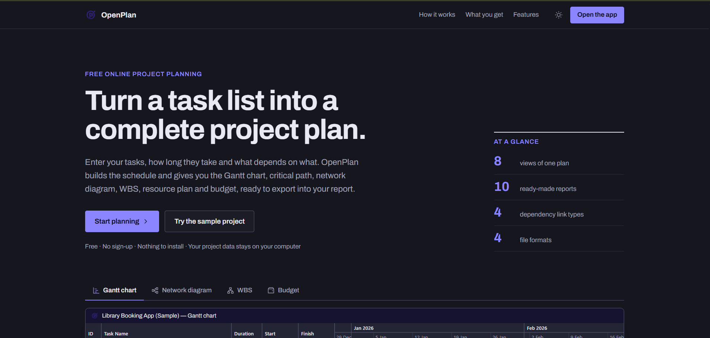
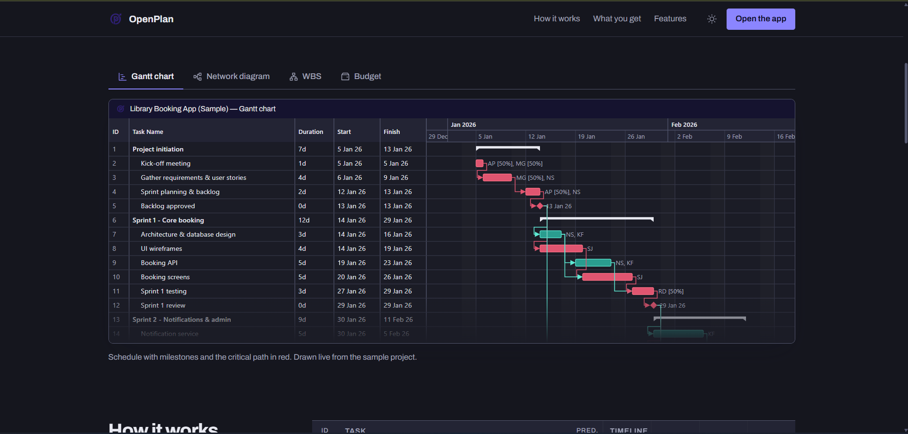
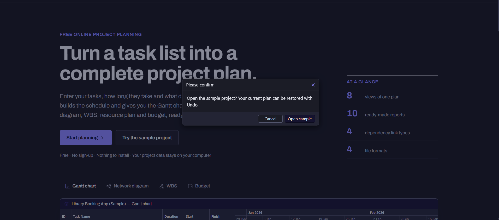
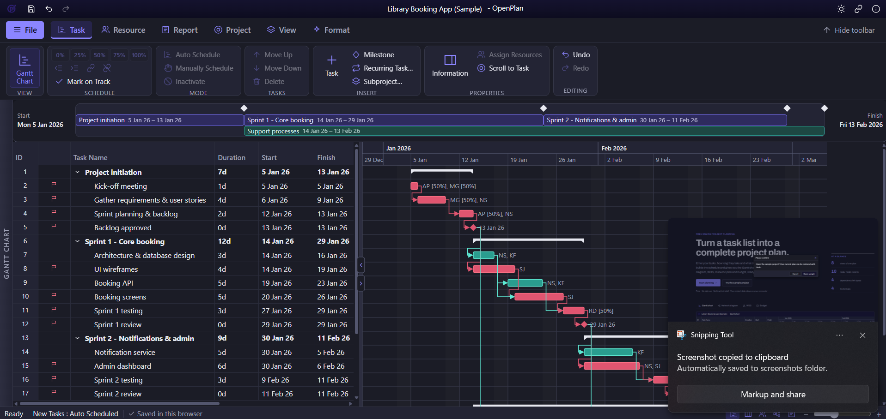

# Neo Project User Guide

Neo Project is a free project planner that runs in your web browser. You list the tasks, how long each takes and what depends on what. Neo Project then builds the schedule, the Gantt chart, the critical path, the resource plan and the budget. It works like Microsoft Project, so if you have used that, most of this will feel familiar.

Your plan is saved in your own browser. Nothing is uploaded and there is no account.

**Contents**

1. [Open the app](#1-open-the-app)
2. [The workspace](#2-the-workspace)
3. [Build your first plan in 7 steps](#3-build-your-first-plan-in-7-steps)
4. [Tasks and durations](#4-tasks-and-durations)
5. [Links between tasks](#5-links-between-tasks)
6. [Auto, manual and inactive tasks](#6-auto-manual-and-inactive-tasks)
7. [Constraints and deadlines](#7-constraints-and-deadlines)
8. [Working time and the project calendar](#8-working-time-and-the-project-calendar)
9. [Resources and costs](#9-resources-and-costs)
10. [Tracking progress](#10-tracking-progress)
11. [Views and reports](#11-views-and-reports)
12. [Saving, opening, exporting and sharing](#12-saving-opening-exporting-and-sharing)
13. [Keyboard shortcuts](#13-keyboard-shortcuts)
14. [Troubleshooting](#14-troubleshooting)

---

## 1. Open the app

Start at the Neo Project home page.

*The home page. **Open the app** (top right) and **Start planning** both open the planner and continue your last plan. **Try the sample project** opens a ready-made example.*

Scroll down for a live preview of what Neo Project draws from the sample project. Use the tabs to switch between the **Gantt chart**, **Network diagram**, **WBS** and **Budget**.

*The preview is drawn from the sample project, so it shows exactly what your own plan will look like.*

If you already have a plan open, choosing **Try the sample project** asks you to confirm first, so you cannot lose work by accident.

*Choose **Open sample** to continue or **Cancel** to keep your plan. The plan you replaced can be brought back with Undo, or from **File › Open › Restore Previous Project**.*

> **Tip:** the sample project is the quickest way to learn. Open it, click around, and use **File › New** when you are ready to start your own.

---

## 2. The workspace

This is the main window.

| Area | What it does |
|---|---|
| **Title bar** (top) | Shows the project name. Click the name to rename it: **Enter** saves, **Esc** cancels. The icons on the left are Save, Undo and Redo. The icons on the right switch dark and light mode, share a copy as a link, and open help. |
| **File** button | Opens the File screen: Info, New, Open, Save, Versions, Export, Print and About. |
| **Tabs** | **Task**, **Resource**, **Report**, **Project**, **View** and **Format** (Format appears when the Gantt chart is open). Each tab shows a ribbon of commands. |
| **Ribbon** | Groups of commands. Greyed-out buttons need something selected first, for example a task. **Hide toolbar** (or **Ctrl+F1**) collapses it to give you more room. |
| **Timeline** | A strip across the top that shows the project phases and milestones from start to finish. Click a phase to jump to it. |
| **Task table** (left) | One row per task: ID, name, duration, start, finish, predecessors, resources and cost. Click a cell and type to edit it. |
| **Gantt chart** (right) | Bars for every task. Red bars are on the **critical path**: a delay to any of them delays the whole project. Arrows show links. Diamonds are milestones. |
| **Splitter** (between table and chart) | Drag it to resize. Drag it to an edge, or use the small arrows, to hide the table or the chart. |
| **Task Information panel** | A side panel with every detail of the selected task. Open it with **Information** on the Task tab, or double-click a bar. |
| **Status bar** (bottom) | Shows the state of your plan and whether it was saved. On the right, the icons switch between views and the slider zooms the chart. |

A small **Getting started** checklist appears the first time you use the app. Close it with the **×**. You can bring it back from **File › About**.

---

## 3. Build your first plan in 7 steps

1. **Start a new plan.** Choose **File › New › Blank Project**, or pick a template (final-year project, software sprint, event, research project).
2. **Name it and set the start date.** Choose **Project › Project Information**, fill in the name, the start date and, if you want it, the manager and budget. Click **Save**.
3. **List the tasks.** In the table, click the grey row at the bottom ("Type a new task name and press Enter…"), type a name and press **Enter**. Repeat. Press **Insert** to add a task below the selected one.
4. **Give each task a duration.** Click the **Duration** cell and type, for example, `5` or `3d`.
5. **Organise into phases.** Select tasks and click **Indent** (the arrow icon on the Task tab, or **Alt+Shift+→**). The task above becomes a **summary task** and adds up its subtasks. **Outdent** (**Alt+Shift+←**) moves them back out.
6. **Link the tasks.** Type the ID of the task that must finish first into the **Predecessors** cell, for example `3`. Or select two or more tasks and click **Link**. The Gantt chart now shows arrows and the critical path.
7. **Save.** Press **Ctrl+S**. Your plan is also autosaved in this browser, but a saved file is the only copy that survives clearing your browser data.

---

## 4. Tasks and durations

### Adding and organising tasks

| To… | Do this |
|---|---|
| Add a task | Type in the bottom row, or **Task** on the Task tab, or **Insert** |
| Add a milestone (a zero-length event) | **Milestone** on the Task tab, or give a task a duration of `0` |
| Add a repeating task | **Recurring Task…** on the Task tab. It creates a summary task with one subtask for each occurrence. |
| Move a task up or down | **Move Up** / **Move Down** on the Task tab |
| Delete tasks | Select them and press **Delete** |
| Select several tasks | **Shift+click** for a range, **Ctrl+click** for separate tasks |
| Hide or show subtasks | The small arrow beside a summary task, or **Expand All** / **Collapse All** on the View tab |

### Typing a duration

| You type | It means |
|---|---|
| `5` or `5d` | 5 working days |
| `2w` | 2 weeks (10 working days) |
| `16h` | 16 hours (2 days with an 8-hour day) |
| `30min` | 30 minutes |
| `1mo` | 1 month (20 working days) |
| `3ed` | 3 **elapsed** days: calendar days that run straight through weekends and holidays, for example while concrete cures |
| `0` | A milestone |

A duration can have decimals, such as `1.5d`.

### The Task Information panel

Select a task and open the panel to change its duration, work, % complete, task type, constraint, deadline, priority, actual dates, fixed cost, predecessors, resources, splits, custom fields and notes.

* **Split task.** Add a pause part-way through a task, for example while you wait for feedback. The bar shows a gap.
* **Effort driven / task type.** These control what changes when you add people. With *Fixed units* and *Effort driven*, adding people shortens the task while the total work stays the same.

---

## 5. Links between tasks

A link says one task depends on another.

### Typing predecessors

In the **Predecessors** cell, type task IDs separated by commas:

| You type | Meaning |
|---|---|
| `3` | Starts after task 3 finishes |
| `3FS` | The same (Finish-to-Start is the default) |
| `3SS` | Starts when task 3 starts (Start-to-Start) |
| `3FF` | Finishes when task 3 finishes (Finish-to-Finish) |
| `3SF` | Finishes when task 3 starts (Start-to-Finish) |
| `3FS+2d` | Starts 2 working days after task 3 finishes (a **lag**) |
| `3FS-1d` | Starts 1 day before task 3 finishes (a **lead**) |
| `3SS+50%` | Starts when task 3 is half done (lag as a percentage of task 3) |
| `3FS+3ed` | Starts 3 calendar days after task 3 finishes (elapsed lag) |
| `2, 5SS+2d, 7FF` | Several links at once |

If a link would create a loop (A depends on B and B depends on A), Neo Project refuses it and says so.

### Other ways to link

* **Link / Unlink** on the Task tab for the selected tasks.
* **Drag** from one Gantt bar onto another to link them (finish-to-start).
* In the Task Information panel, use **Add** under *Predecessors* and choose the type, the lag and its unit (days, %, or elapsed days).

---

## 6. Auto, manual and inactive tasks

### Auto scheduled (the default)

Neo Project decides the dates from the links, constraints and calendar.

### Manually scheduled

Select a task and choose **Manually Schedule** on the Task tab (or set the **Task mode** column). The task keeps the dates you give it:

* Type a new **Start** (and optionally **Finish**) in the table, or drag the bar.
* Links and constraints no longer move it. If its start is earlier than its predecessors allow, Neo Project flags the conflict.
* Its successors still follow it.

Choose **Auto Schedule** to hand control back. Manual bars are drawn with a dashed outline.

### Inactive tasks

Select a task and choose **Inactivate**. It stays in the plan, struck through, but its dates, cost, work and links stop counting. Use this for "what if we drop this?" without deleting anything. Choose **Activate** to bring it back.

---

## 7. Constraints and deadlines

By default, tasks start as soon as their links allow (**As soon as possible**). Change this in the Task Information panel, or in the **Constraint** and **Constraint date** columns (View › Tables).

| Constraint | Meaning |
|---|---|
| As soon as possible / As late as possible | Earliest / latest the links allow |
| Start no earlier than / Finish no earlier than | A date the task cannot begin (or end) before |
| Start no later than / Finish no later than | A date it must not pass |
| Must start on / Must finish on | An exact date |

A **deadline** is a target. It does not move the task, but the chart shows a marker and warns you if the task finishes after it.

Typing a **Start** date in the table sets *Start no earlier than*. Typing a **Finish** date sets *Finish no earlier than*. You can type `5 Jan 26`, `2026-01-05` or `05/01/2026` (day first).

If a constraint conflicts with the links, a warning bar appears above the table. Click **Show them** to list the tasks.

---

## 8. Working time and the project calendar

Choose **Project › Change Working Time**.

* **Working days.** Tick the days your team works. The default is Monday to Friday.
* **Exceptions.** Add holidays, shutdowns or extra working days. Give each a name, a date range, and choose **Non-working** or **Working** (for example a working Saturday). Where exceptions overlap, the later row wins.

Every task is scheduled on this calendar. Individual people can have their own days off in the **Resource Sheet**.

### Schedule from the finish date

In **Project › Project Information**, set **Schedule from** to *Project finish date* and enter the date you must finish. Neo Project works backwards, pushes every task as late as it can go, and works out the start date for you.

### Critical path sensitivity

In the same dialog, **Critical if slack ≤ (days)** lets you treat nearly-critical tasks as critical, for example tasks with one day of slack.

---

## 9. Resources and costs

### Add people and materials

1. On the **Resource** tab, choose **Resource Sheet**, then **Add Resources**.
2. Fill in the name, type and rate. There are three kinds of resource:

| Kind | Use it for | Rate |
|---|---|---|
| **Work** | People | Cost per hour |
| **Material** | Things you consume | Cost per unit, and a unit label such as "licences" |
| **Cost** | Travel, fees, licences | No rate: enter the amount on each task |

3. Click a resource to set **working days**, **vacations**, **rate changes** (a new hourly rate from a date) and **cost per use**.

### Assign them to tasks

Select a task and choose **Assign Resources**, or click the **Resources** cell. In the panel, pick a resource. The number beside it means:

* **Work resource:** the percentage of that person's day (100% is full time)
* **Material:** the quantity
* **Cost:** the amount

### Overallocation and leveling

If a person is booked for more than their maximum units on any day, the task shows a warning icon. Use **Next Overallocation** to jump to it. **Level All** delays tasks to fix overbooking, and **Clear Leveling** undoes that. Tasks that have started, are in progress or are fixed with *Must start on* will not move.

### Budget

**Report › Cost & Budget** shows cost by work package and by resource, monthly and cumulative cost, and your budget line (set in Project Information).

---

## 10. Tracking progress

1. **Set a baseline** when the plan is agreed: **Project › Set Baseline**. This saves the current dates and costs to measure against. A grey bar under each task shows the baseline.
2. **Set the status date** (Project › Project Information) to the date you are reporting on.
3. **Update each task.** Use the **0% / 25% / 50% / 75% / 100%** buttons on the Task tab, or type in the **% Complete** column. **Mark on Track** sets every task to what the plan says should be done by the status date.
4. **Read the results.** Tasks behind schedule get a clock icon. The **Variance** and **Earned value** columns (View › Tables) show how far each task has slipped. **Report › Earned Value** gives the project totals: SPI, CPI, estimate at completion and more.

---

## 11. Views and reports

Switch views from the **View** tab, the **Resource** tab or the icons at the right of the status bar.

| View | Shows |
|---|---|
| **Gantt Chart** | Task table plus bars and links |
| **Task Board** | Not started / In progress / Done columns. Drag a card to update its % complete. |
| **Network Diagram** | Tasks as boxes with early and late dates, slack and the critical path |
| **WBS Chart** | The work breakdown structure as a tree |
| **Resource Sheet** | Everyone and everything you can assign |
| **Team Chart** | Who reports to whom |
| **Resource Usage** | A heat map of each person's workload by day |

On the **View** tab you can also **Sort**, **Filter** (for example Critical tasks, Milestones, Behind schedule, Overallocated), **Group** (by progress, resource, priority and more), choose which columns to show under **Tables**, change the **Timescale** (days, weeks, months, quarters), and turn the **Timeline** and **Details** panels on and off. **Dark Mode** is here too.

The **Format** tab (Gantt chart only) switches critical-path colouring, the baseline bars and the date format, and offers four bar colour schemes.

### Reports

The **Report** tab has ready-made reports: Dashboard, Resources, Costs, In Progress, Earned Value, and under **More Reports**: Critical Tasks, Milestones, Who Does What, Baseline Variance and Task List. Use **Print** to print or save as PDF, and the Export buttons for a picture, Excel or CSV.

---

## 12. Saving, opening, exporting and sharing

### Saving

* **Autosave** keeps your plan in this browser after every change. It disappears if you clear browser data, so keep a file for anything important.
* **Ctrl+S** (or **File › Save**) writes an `.neoproject` file. In Chrome and Edge, the first save asks where to put it and later saves update the same file. **Save As** makes a copy. Other browsers download the file.
* **File › Versions** saves named copies, such as "Before sprint 2", that you can restore later. They are kept in this browser only.

### Opening

**File › Open › Browse…** opens an `.neoproject` file, an older `.json` file, or a **Microsoft Project XML** (`.xml`) file. The plan you were working on is kept, so **Restore Previous Project** brings it back.

### Working with Microsoft Project

* **Export:** **File › Export › Microsoft Project XML**, then in MS Project choose **File › Open** and pick the `.xml` file.
* **Import:** in MS Project, choose **File › Save As** and save as **XML**, then open that file in Neo Project.
* Tasks, outline levels, durations, links and lags, constraints, deadlines, manual and inactive tasks, the work week and exceptions, resources and assignments carry over. Baselines, timephased data, custom attributes, task and resource calendars and cross-project links do not, and Neo Project tells you when it skips something.

### Other files

* **Excel (.xlsx)** and **CSV**: export the task table. To import, choose **File › Open › Import from Excel or CSV…**, then paste a task list from a spreadsheet or pick a CSV file. Columns are matched by heading: Task Name, Duration, Predecessors, Resources, Level or WBS, % Complete, Notes.
* **Picture (PNG) or vector (SVG)** of the current Gantt, network, WBS or team chart.
* **Insert as Subproject…** adds another project file under a new summary task.
* **Share a copy as a link** (the link icon in the title bar). The whole plan travels inside the link, nothing is uploaded, and whoever opens it gets their own copy.

### Opening files by double-clicking

In Chrome or Edge, install Neo Project from the address bar (**Install** icon). After that, double-clicking an `.neoproject` file opens it in Neo Project.

---

## 13. Keyboard shortcuts

| Keys | Action |
|---|---|
| **Ctrl+S** | Save |
| **Ctrl+Z** / **Ctrl+Y** | Undo / redo |
| **Ctrl+F1** | Hide or show the toolbar |
| **Alt+Shift+→** / **←** | Indent / outdent the selected tasks |
| **Insert** | Insert a task |
| **Delete** | Delete the selected tasks |
| **↑** / **↓** or **Enter** | Move between rows while editing |
| **Esc** | Cancel the edit you are typing |

---

## 14. Troubleshooting

| Problem | What to do |
|---|---|
| "That link would create a dependency loop" | Two tasks depend on each other, directly or through others. Remove one of the links. |
| A task will not start where I dragged it | Its predecessors or a constraint are holding it. The message tells you the earliest date. Make it a **manual** task to place it exactly. |
| A red warning bar about constraints | A constraint date is earlier than the links allow. Click **Show them** and fix or remove the constraint. |
| A resource shows a warning icon | The person is overbooked on those days. Use **Level All**, lower the units, or add working days. |
| Dates look wrong around holidays | Check **Project › Change Working Time** for the work week and exceptions. |
| My plan disappeared | Try **Ctrl+Z**, then **File › Open › Restore Previous Project**, then **File › Versions**. Autosave lives in one browser on one computer, so a different browser or a cleared cache will not have it. |
| The file will not open | Neo Project opens `.neoproject`, `.json` and Microsoft Project `.xml` files, up to 20 MB. |
| The Finish column is cut off | Drag the splitter to the right, or scroll the table sideways. |

---

*Neo Project is open source under the MIT licence.*
